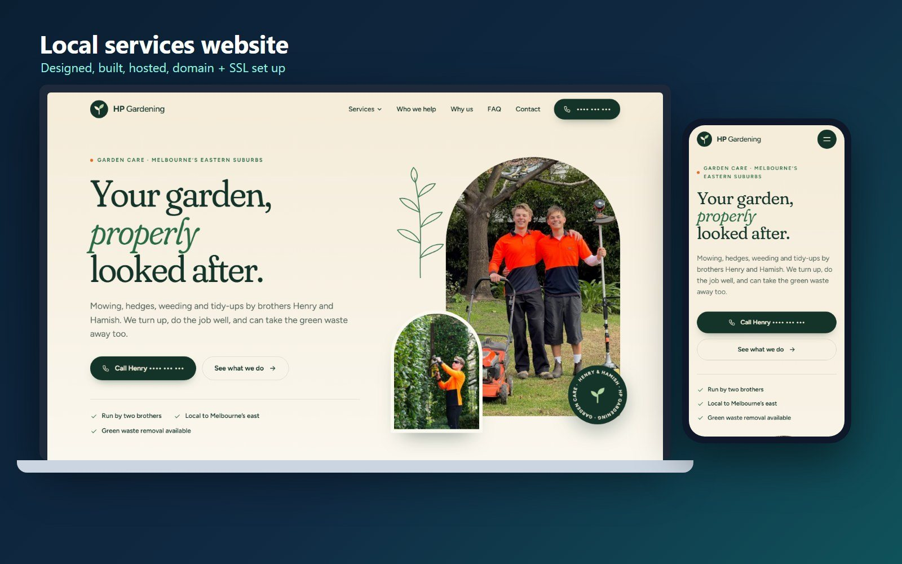
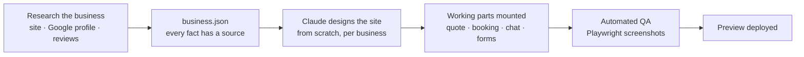

# Small-business websites: designed, built, hosted

Websites I've designed, built and host for local service businesses: some hand-crafted, some produced by an AI website pipeline I built. Each one is mobile-first, fast, and set up end to end: domain, DNS, SSL, hosting and search basics.

> The code for these sites is private. This repo is a showcase with screenshots and live links.

---

## HP Gardening: [hpgardening.com.au](https://hpgardening.com.au)

A premium brochure site for a two-brother gardening business in Melbourne's east.

- Custom design built from their flyer: forest green, sage and cream, arch-framed photos, and a two-leaf logo mark
- Static pages generated by a zero-dependency Node build script, with hand-written CSS and JS, so copy changes take seconds
- Their own photos optimised to WebP, with a few AI-generated scene images to fill gaps (never in place of real work photos)
- Automated layout QA with Playwright at phone, tablet and desktop widths
- Domain registered, DNS configured, served over HTTPS from my own server

## Northside Gutter Care: [live demo](https://aiwithoutjargon.com.au/northside-gutter-care/)

A demo site for a (fictional) gutter-cleaning business, built by my **AI website pipeline** to show what a fully kitted-out trade website can do:

- **Instant quote built in:** type your address and get your gutter price (see [instant-quote-saas](../../../instant-quote-saas))
- **AI receptionist:** the Call button rings a receptionist that answers in the business's name (see [ai-receptionist](../../../ai-receptionist))
- Website chat, enquiry forms, service-area pages, reviews and a regular-maintenance plan signup

### How the pipeline works

- **Facts are data, not copy.** Phone numbers, hours, prices and reviews sit in data slots filled at request time, so the owner can update them without a redesign.
- **Every claim has a source.** The research step records where each fact came from, so the site never invents things about a real business.
- **No templates.** Each site is designed for that business, then the shared working parts (quote tool, booking, chat) plug in.

## Built with

HTML, CSS and JavaScript · Node.js build scripts · Claude (design and research agents) · sharp (images) · Playwright (QA) · Caddy (hosting and SSL) · DNS and domain setup

---

**Need a website for your business?** Get in touch through my profile.
